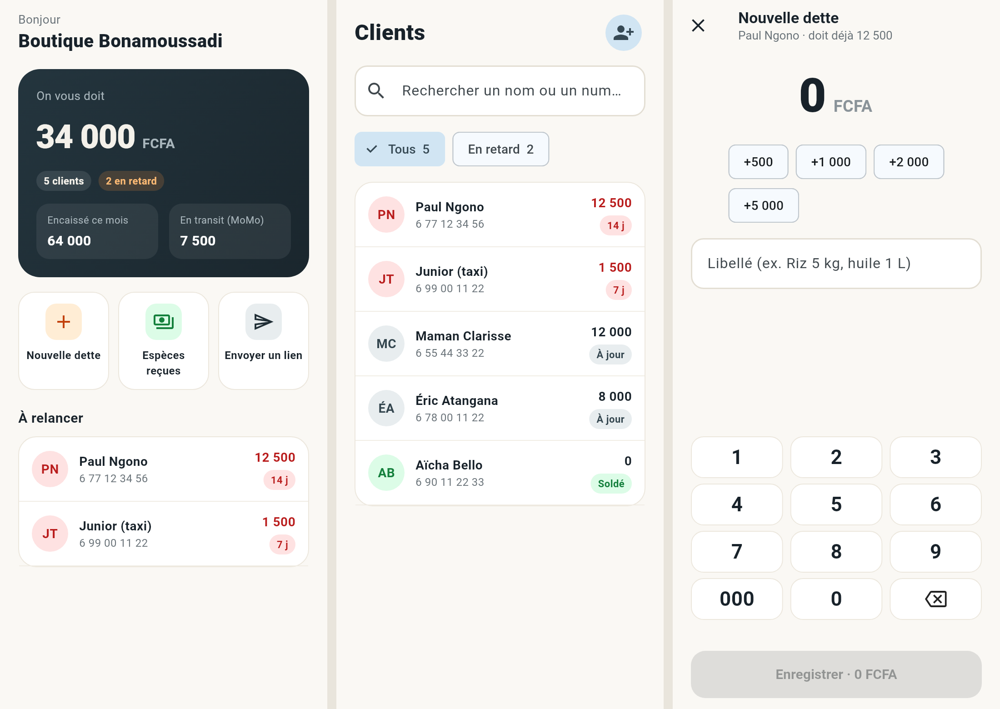
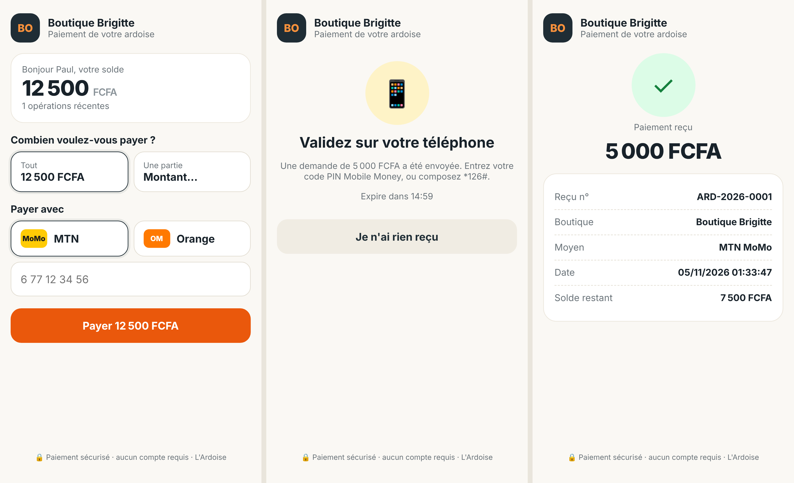
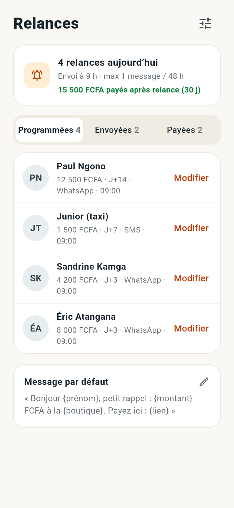

# L'Ardoise

Le cahier de crédit du boutiquier, sans le cahier : les dettes sont notées en 3 secondes, même sans réseau, et le client rembourse par MTN MoMo ou Orange Money via un lien WhatsApp.

| Dossier | Rôle | Stack |
|---|---|---|
| `packages/pay-core` | Module paiement réutilisable (partagé avec Njangi Pro) : interface `PaymentProvider`, adaptateur NotchPay, fournisseur sandbox local, machine à états, numéros camerounais, signatures HMAC | TypeScript, Vitest |
| `apps/api` | API de la boutique, page de paiement publique, webhooks, tâche de rattrapage | NestJS 11, Prisma 7, PostgreSQL 16 |
| `apps/mobile` | App du commerçant, hors-ligne d'abord | Flutter 3.47, SQLite (sqflite), Provider |





Captures de l'app régénérables avec `cd apps/mobile && flutter test tool/screenshots_test.dart --update-goldens`.

## Démarrer en local

Prérequis : Node 20+, pnpm 10, PostgreSQL 16, Flutter 3.47 (et le SDK Android pour compiler l'APK).

```bash
./scripts/dev-services.sh
```

```bash
pnpm install
```

```bash
cp apps/api/.env.example apps/api/.env
```

```bash
cd apps/api && npx prisma migrate deploy && npx prisma generate && pnpm dev
```

L'API écoute sur `http://localhost:3000`. Avec `PAYMENT_PROVIDER=sandbox` (défaut en dev), aucun appel réseau n'est fait vers un opérateur. `OTP_DEV_ECHO=true` renvoie le code SMS dans la réponse de `/auth/otp/request`, et l'app le pré-remplit.

Simuler la validation d'un paiement par le client (le « code PIN MoMo ») :

```bash
curl -X POST http://localhost:3000/dev/sandbox/<transactionId>/success
```

Issues possibles : `success`, `fail`, `expire`. En sandbox, un numéro payeur finissant par `0000` est refusé, et un numéro finissant par `9999` simule un fournisseur injoignable.

App mobile, sur un émulateur Android (`10.0.2.2` = la machine hôte) :

```bash
cd apps/mobile && flutter run --dart-define=API_URL=http://10.0.2.2:3000
```

APK de test :

```bash
cd apps/mobile && flutter build apk --release --dart-define=API_URL=https://api.votre-domaine.cm
```

## Tests

```bash
pnpm -r test
```

```bash
cd apps/mobile && flutter test
```

Test d'intégration de l'app contre l'API locale (API démarrée) :

```bash
cd apps/mobile && ARDOISE_API_URL=http://localhost:3000 flutter test
```

| Suite | Tests | Ce qui est couvert |
|---|---|---|
| `pay-core` | 14 | États, numéros, adaptateur NotchPay (requêtes exactes, erreurs, statuts), signatures, sandbox |
| `api` | 46 | Auth OTP (limites), isolation entre boutiques, idempotence, synchro rejouée, annulations, plafond, tableau de bord, critères d'acceptation paiement, et relances (9 tests des règles + 11 de bout en bout sur PostgreSQL) |
| `mobile` | 10 | Saisie hors-ligne puis synchro sans doublon, rejeu après coupure, rattachement d'un client déjà connu, saisie rejetée, pavé numérique et écran Relances sur petit écran (360 × 640), intégration réelle avec l'API |

Critères d'acceptation paiement vérifiés automatiquement :

- [x] Un paiement partiel de 2 000 sur 5 000 laisse un solde de 3 000, avec un reçu.
- [x] Le même webhook envoyé 3 fois ne crédite qu'une fois, y compris 6 webhooks concurrents.
- [x] Un paiement refusé ou expiré ne modifie pas le solde et peut être retenté.
- [x] Un webhook à signature invalide est rejeté et journalisé.
- [x] Un paiement dont le webhook est perdu est récupéré par la tâche de rattrapage.
- [x] Une saisie hors-ligne n'apparaît qu'une seule fois après synchro.
- [x] Le grand livre reste équilibré et chaque paiement réussi a exactement une écriture et un reçu.

## Relances automatiques



| Règle | Où |
|---|---|
| Paliers **J+3, J+7, J+14**, comptés depuis le début de la période de dette (le solde passe de 0 à positif). Un client qui achète chaque jour sans payer garde la même date de départ | `apps/api/src/reminders/rules.ts` |
| **1 message au plus par 48 h** par client, et aucun dans les 48 h qui suivent un paiement | idem, revérifié au moment de l'envoi |
| **Entre 8 h et 20 h**, heure de Douala (UTC+1), à l'heure choisie par la boutique (9 h par défaut) | idem |
| Rattrapage (serveur arrêté, relances réactivées) : **un seul message**, le palier le plus avancé, jamais une rafale | idem |
| **WhatsApp d'abord, SMS en repli** si le client n'a pas WhatsApp | `reminders/messaging.ts` |
| Chaque message contient un **nouveau lien de paiement** et la mention de désinscription. La page de paiement propose « Ne plus recevoir de rappels » (fonctionne même si le lien a expiré) | `POST /public/links/:token/opt-out` |
| Relance annulée dès que la dette est réglée, que le client refuse les rappels ou que la boutique les désactive | `RemindersService.plan` |
| **Jamais deux fois le même message** : réservation conditionnelle `SCHEDULED → SENDING`, contrainte unique `(client, période, palier)`, planification sérialisée par boutique (verrou consultatif PostgreSQL). Un envoi interrompu par un arrêt brutal est marqué en échec, pas renvoyé | testé avec envois et planifications concurrents |
| « Payées après relance » : paiements reçus dans les 7 jours suivant une relance (et avant la suivante) | `GET /reminders` |

API (JWT) :

- `GET /reminders` : réglages, relances du jour, programmées, envoyées et payées (30 jours), montant récupéré ;
- `PATCH /reminders/settings` : `enabled`, `sendHour` (8 à 19), `channel` (`WHATSAPP` ou `SMS`), `template` (`null` = message par défaut ; `{lien}` obligatoire, 300 caractères au plus) ;
- `PATCH /reminders/:id` : `action` = `postpone` (demain), `skip`, `set_channel`, `send_now`.

La tâche tourne toutes les 5 minutes quand `ENABLE_JOBS=true`. En développement, les messages WhatsApp et SMS sont écrits dans les logs de l'API.

## Règles de conception

- **Montants en entiers FCFA**, jamais de flottants.
- **Le solde n'est jamais stocké** : c'est la somme des lignes du grand livre en double entrée (`recv:`, `sales:`, `cash:`, `transit:`).
- **Rien n'est effacé** : une erreur se corrige par une écriture inverse, visible et barrée dans l'historique.
- **Idempotence partout** : chaque saisie porte un UUID généré par le téléphone ; chaque paiement porte une référence unique envoyée au fournisseur ; la contrainte `ledger_entries.transaction_id UNIQUE` et un verrou `SELECT … FOR UPDATE` empêchent tout double crédit.
- **Le webhook n'est jamais cru sur parole** : signature vérifiée sur le corps brut, puis statut relu chez le fournisseur avant de créditer. Un montant confirmé différent du montant demandé est crédité tel quel et signalé (`review_required`).
- **Un timeout n'est pas un échec** : une initiation sans réponse reste en attente et la tâche de rattrapage tranche.
- **Hors-ligne d'abord** : l'app écrit dans SQLite, affiche le solde serveur plus les saisies en attente, et synchronise dès que le réseau revient.

## Écarts assumés par rapport au cahier des charges

| Cahier des charges | Choix fait | Pourquoi |
|---|---|---|
| Page de paiement en Next.js | Page HTML servie par l'API (`GET /p/:token`, ~10 Ko) | Un seul déploiement, aucune dépendance, bien sous la cible de 150 Ko en 3G |
| Webhooks et relances dans une file BullMQ | Transaction SQL courte pour les webhooks ; tâche périodique `@nestjs/schedule` pour les relances, avec réservation en base | Pas de Redis à opérer pour le MVP ; l'unicité des envois est garantie par PostgreSQL, testée en concurrence |
| Drift pour SQLite | sqflite + SQL explicite | Pas de génération de code ; la file d'attente est simple |

## À faire avant la production

1. **NotchPay** : `developer.notchpay.co` était inaccessible depuis l'environnement de développement. Les endpoints viennent du SDK officiel `notchpay.js`. Trois points restent à confirmer dans la doc :
   - le nom de l'en-tête de signature des webhooks (`NOTCHPAY_WEBHOOK_HEADER`, défaut `x-notch-signature`) et le secret à utiliser ;
   - la liste exacte des statuts ;
   - la forme du corps des webhooks.
2. **SMS** : brancher un vrai fournisseur (implémenter `SmsSender`). Aujourd'hui le code est écrit dans les logs.
3. **WhatsApp** : brancher WhatsApp Business Platform (implémenter `WhatsAppSender`). Meta impose un **modèle de message approuvé** (catégorie « utilitaire ») pour écrire en premier à un client : faire valider le message par défaut avec ses 4 variables. Un message personnalisé par la boutique ne peut partir que par SMS tant qu'il n'est pas approuvé. Prévoir aussi la réception du mot « STOP » (webhook entrant) en plus du lien de désinscription.
4. **Réconciliation quotidienne** avec le relevé de l'agrégateur.
5. **Payout** vers le compte MoMo du commerçant (V2) et vérification COBAC / BEAC.
6. **Plages de numéros** MTN / Orange (`pay-core/src/phone.ts`) à confirmer.
